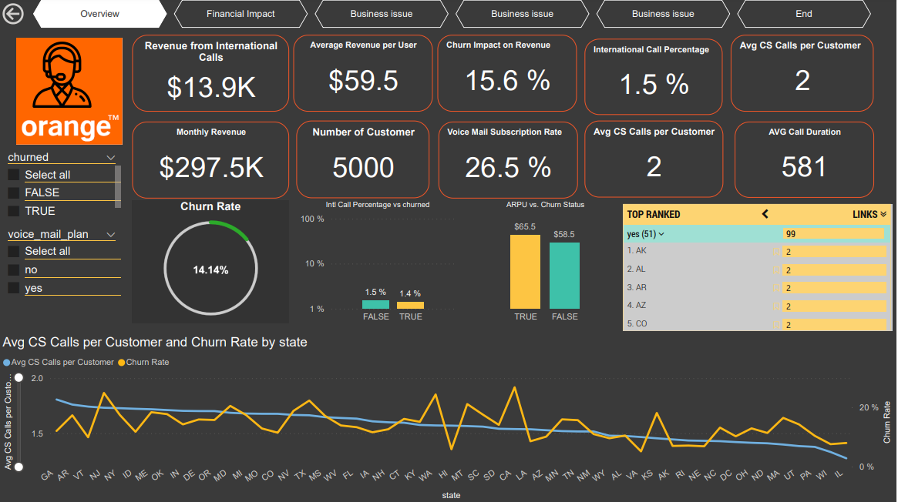

<p align="center">
  
</p>

<h1 align="center">Orange Telecom Customer Churn Intelligence System</h1>

<p align="center">
  <strong>Production-Grade Machine Learning System for Subscriber Attrition Forecasting & Proactive Retention</strong>
</p>

<p align="center">
  
  
  
  
  
  
  
  
</p>

---

## 📌 Executive Summary

Customer attrition is one of the highest cost drivers in the telecommunications industry. This repository contains an **end-to-end, production-grade Machine Learning Engineering system** designed to predict subscriber churn for Orange Telecom.

The system processes multi-channel calling usage, billing metrics, and customer service friction points to:
1. **Predict churn probability** with calibrated risk assessment (**95.0% Accuracy, 0.905 ROC-AUC**).
2. **Classify subscribers into actionable risk tiers** (`LOW`, `MEDIUM`, `HIGH`).
3. **Pinpoint the exact behavioral drivers** contributing to attrition.
4. **Prescribe automated, targeted retention playbooks** for account managers and customer success teams.
5. **Serve predictions via high-throughput REST APIs and an enterprise Streamlit dashboard.**

---

## 🏆 Model Performance Benchmark

Evaluated on a stratified hold-out test set (1,000 unseen subscribers, 14.1% churn rate):

| Metric | Hold-out Score | Business Impact |
| :--- | :---: | :--- |
| **ROC-AUC** | **0.9054** | Exceptional discriminative power between churners and retained subscribers |
| **PR-AUC (Avg Precision)** | **0.8491** | High performance under heavy class imbalance (14.1% positive class) |
| **Accuracy** | **95.00%** | Reliable overall classification accuracy |
| **Precision** | **86.99%** | 87% of flagged high-risk accounts are genuine churners (minimal wasted retention budget) |
| **Recall (Sensitivity)** | **75.89%** | Captures ~76% of all impending churners proactively |
| **F1-Score** | **0.8106** | Balanced harmonic precision-recall performance |

### Confusion Matrix (Test Set: 1,000 Subscribers)

```
                     Predicted Retained (0)    Predicted Churned (1)
Actual Retained (0)           843 (TN)                 16 (FP)
Actual Churned  (1)            34 (FN)                107 (TP)
```

---

## 🔍 Key Business Findings & Feature Importance

Analysis of the trained ensemble model reveals the primary drivers of subscriber churn:

1. **Customer Service Friction (`number_customer_service_calls` - 15.5% importance)**:
   - Subscribers calling customer service **4 or more times** have a churn probability exceeding **70%**. This points to chronic service quality or unresolved billing disputes.
2. **Daytime Bill Exposure (`total_day_charge` & `total_day_minutes` - 28.1% combined)**:
   - High daytime usage under standard per-minute tariffs creates billing shocks that accelerate competitor migration.
3. **International Plan Disconnect (`intl_plan` - 10.5% importance)**:
   - Customers paying monthly plan fees for international add-ons without utilizing international calls churn due to perceived poor value. Conversely, customers with high international volume lacking an international discount plan churn due to unexpected surcharges.

<p align="center">
  
</p>

---

## 🏗️ Architecture & Project Structure

The project follows clean architecture principles with strict separation of concerns:

```
Customer-Churn-Prediction-for-a-Telecom-Company-/
├── .github/
│   └── workflows/
│       └── ci.yml                     # Multi-version CI test & lint pipeline
├── dataset/
│   ├── Orange_Telecom_Churn_Data.csv  # 5,000 raw subscriber records
│   └── out.csv                        # Processed benchmark dataset
├── Dashboard/
│   ├── churn.pbix                     # Interactive Power BI report
│   ├── churn.pdf                      # Executive PDF analytics presentation
│   └── churn.png                      # Dashboard visualization snapshot
├── models/
│   ├── churn_pipeline.joblib          # Self-contained Scikit-Learn Pipeline artifact
│   └── model_metadata.json            # Model parameters, feature names, metrics
├── src/
│   └── telecom_churn/
│       ├── __init__.py                # Package version and exports
│       ├── config.py                  # Centralized configuration dataclass
│       ├── schemas.py                 # Pydantic V2 input/output schemas
│       ├── data/
│       │   ├── loader.py              # Schema validation & stratified splitting
│       │   └── preprocessor.py        # ColumnTransformers & sanitizers (zero leakage)
│       ├── models/
│       │   ├── pipeline.py            # End-to-end Pipeline factory
│       │   ├── trainer.py             # Reproducible training & evaluation engine
│       │   ├── evaluator.py           # Multi-metric evaluation & feature ranking
│       │   └── predictor.py           # Inference engine with risk tiering & rules
│       ├── api/
│       │   └── app.py                 # Production FastAPI REST API
│       ├── ui/
│       │   ├── app.py                 # Enterprise Streamlit dashboard
│       │   └── styles.py              # Brand styling & glassmorphic tokens
│       └── cli.py                     # Unified CLI: train, evaluate, predict, serve
├── tests/
│   ├── conftest.py                    # Pytest fixtures
│   ├── test_schemas.py                # Schema validation tests
│   ├── test_data.py                   # Data ingestion tests
│   ├── test_preprocessor.py           # Transformer unit tests
│   ├── test_pipeline.py               # Pipeline assembly tests
│   ├── test_predictor.py              # Inference & recommendation tests
│   └── test_api.py                    # FastAPI integration tests
├── app.py                             # Root entrypoint for Streamlit Cloud
├── orange_churn.py                    # Backward-compatible UI entrypoint
├── Dockerfile                         # Production container definition
├── docker-compose.yml                 # Orchestration for API + UI
├── pyproject.toml                     # PEP 517 build & tooling spec
├── requirements.txt                   # Production dependencies
├── requirements-dev.txt               # Development & CI dependencies
└── README.md                          # Documentation
```

---

## ⚡ Quickstart Guide

### 1. Installation

Clone the repository and set up a Python virtual environment:

```bash
git clone https://github.com/abduallheid/Customer-Churn-Prediction-for-a-Telecom-Company-.git
cd Customer-Churn-Prediction-for-a-Telecom-Company-

# Create virtual environment
python -m venv .venv

# Activate environment
# On Linux/macOS:
source .venv/bin/activate
# On Windows PowerShell:
.\.venv\Scripts\Activate.ps1

# Install package and dependencies
pip install -r requirements-dev.txt
pip install -e .
```

### 2. Model Training via CLI

Retrain or benchmark models using the built-in CLI:

```bash
# Train default Random Forest pipeline
python -m telecom_churn.cli train --algorithm random_forest

# Train Gradient Boosting pipeline
python -m telecom_churn.cli train --algorithm gradient_boosting

# Evaluate saved model on holdout test set
python -m telecom_churn.cli evaluate
```

### 3. Run the Test Suite

Execute 24 automated unit and integration tests:

```bash
pytest -v tests
```

---

## 🚀 Running the Web Applications

### A. Launch Interactive Streamlit Dashboard

```bash
streamlit run app.py
```
*Accessible at `http://localhost:8501`*

**Dashboard Features:**
- **Single Account Risk Simulator**: Interactive sliders and preset customer personas with instant probability gauge and tailored retention advice.
- **Batch Customer File Scoring**: Drag-and-drop CSV scoring with cohort metrics and 1-click export of annotated results.
- **Model Insights & Explainability**: Confusion matrix, feature importance charts, and Power BI report downloads.

### B. Launch FastAPI REST Service

```bash
uvicorn telecom_churn.api.app:app --host 0.0.0.0 --port 8000 --reload
```
*API docs available at `http://localhost:8000/docs`*

---

## 🔌 API Reference & Usage

### 1. Health Probe
```http
GET /health
```
```json
{
  "status": "healthy",
  "version": "1.0.0",
  "model_loaded": true,
  "model_version": "random_forest"
}
```

### 2. Single Customer Prediction
```http
POST /predict
Content-Type: application/json
```
```json
{
  "account_length": 128,
  "intl_plan": "no",
  "voice_mail_plan": "yes",
  "number_vmail_messages": 25,
  "total_day_minutes": 265.1,
  "total_day_calls": 110,
  "total_day_charge": 45.07,
  "total_eve_minutes": 197.4,
  "total_eve_calls": 99,
  "total_eve_charge": 16.78,
  "total_night_minutes": 244.7,
  "total_night_calls": 91,
  "total_night_charge": 11.01,
  "total_intl_minutes": 10.0,
  "total_intl_calls": 3,
  "total_intl_charge": 2.70,
  "number_customer_service_calls": 1
}
```

**Response:**
```json
{
  "churn_prediction": false,
  "churn_probability": 0.1245,
  "risk_tier": "LOW",
  "confidence": 0.751,
  "key_drivers": [
    "Healthy usage across all call categories with minimal service friction"
  ],
  "recommendations": [
    "Maintain standard service engagement; eligible for premium cross-sell offers."
  ]
}
```

### 3. Batch CSV Scoring
```bash
curl -X POST "http://localhost:8000/predict/upload-csv?download_as_csv=true" \
  -F "file=@dataset/Orange_Telecom_Churn_Data.csv" \
  --output scored_customers.csv
```

---

## 🐳 Docker Deployment

Run both the FastAPI backend and Streamlit dashboard in containerized environments:

```bash
# Build and start all services via Docker Compose
docker-compose up --build -d

# Check running services
docker-compose ps
```

- **REST API Docs**: `http://localhost:8000/docs`
- **Streamlit Dashboard**: `http://localhost:8501`

---

## 📊 Business Intelligence Assets

Located in [`Dashboard/`](Dashboard/):
- **[`churn.pbix`](Dashboard/churn.pbix)**: Power BI interactive workbook containing subscriber distribution, call duration patterns, state-by-state churn, and financial impact dashboards.
- **[`churn.pdf`](Dashboard/churn.pdf)**: Executive slide deck report summarizing analytical KPI findings.
- **[`churn.png`](Dashboard/churn.png)**: Visual report snapshot.

---

## 👤 Author & Contact

**Eng: Abduallh Eid**
- **Email**: [abduallheid87@gmail.com](mailto:abduallheid87@gmail.com)
- **GitHub**: [@abduallheid](https://github.com/abduallheid)
- **Live Streamlit App**: [Orange Telecom Churn App](https://orangechurn.streamlit.app/)

---

## 📄 License

This project is licensed under the MIT License - see the LICENSE file for details.
